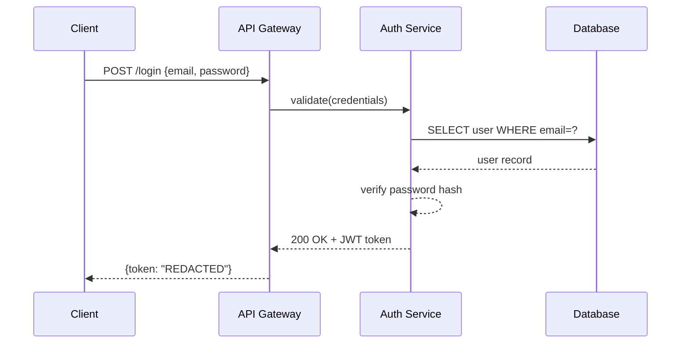
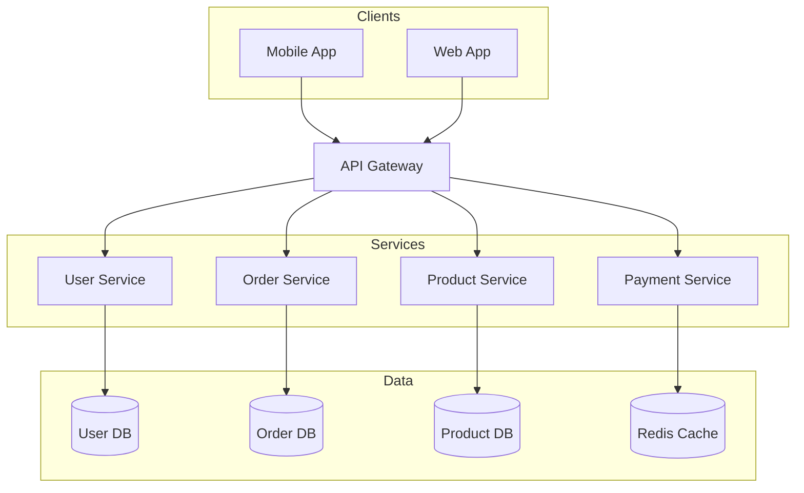
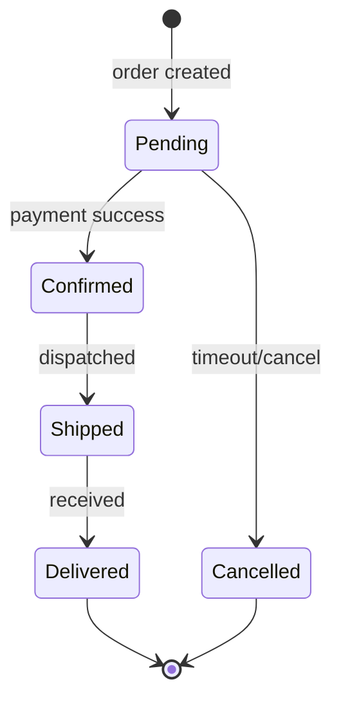

# Mermaid Diagrams (local-only, hardened)

Generate `.mmd` text files and export to PNG/SVG/PDF using `mmdc` (local renderer).

**Key advantage:** Text-based syntax with **fully automatic layout** — no x/y coordinates needed.

> **Data privacy:** ta wersja celowo renderuje **wylacznie lokalnie**
> przez `mmdc`. Oryginalny skill mial fallback do publicznego API `kroki.io`, ktory
> POST-uje TRESC diagramu na zewnetrzny serwer — usuniety, bo nazwy systemow/architektury
> nie moga opuszczac maszyny. Jesli `mmdc`/Chrome nie dziala, **zainstaluj je** (sekcja
> Prerequisites) — **nie** wysylaj diagramu nigdzie na zewnatrz.

## When to use / when NOT to use

**Use this skill for:** diagrams-as-code with automatic layout (flowchart, sequence, class, state, ER, gantt, mindmap) — text source that lives in git and embeds in Markdown.

**Do NOT use it — route elsewhere — for:**
- Pixel-precise placement, custom layout, branded icons, or heavy styling → **drawio**.
- A hand-drawn / sketchy aesthetic → **excalidraw** or **tldraw**.
- A freeform whiteboard or freehand strokes → **tldraw**.
- Strict, conventional UML notation → **plantuml**.

## Prerequisites — local mmdc

> **Przyklad konfiguracji (2026-06-24):** mermaid-cli **v11.15.0** z instalacja globalna,
> przegladarka = `chrome-headless-shell` podpieta przez `PUPPETEER_EXECUTABLE_PATH` (user scope).
> To datowany przyklad, nie potwierdzenie instalacji na maszynie czytelnika.
> Ponizej zostaje udokumentowana procedura odtworzenia konfiguracji.

`mmdc` renderuje przez Puppeteer, ktory potrzebuje binarki Chromium. Procedura odporna na
typowy blad instalacji na Windows:

1. **Instaluj mermaid-cli z POMINIECIEM pobierania przegladarki.** Domyslny postinstall ciagnie
   pelnego Chrome (duzy plik) — na Windows czesto sie urywa (`end of central directory record
   signature not found`) i wywala cala instalacje. Pomin go:
   ```powershell
   # CMD:         set PUPPETEER_SKIP_DOWNLOAD=true && npm install -g @mermaid-js/mermaid-cli
   # PowerShell:  $env:PUPPETEER_SKIP_DOWNLOAD="true"; npm install -g @mermaid-js/mermaid-cli
   ```
2. **Pobierz lekka, headless Chromium** (pelny Chrome niepotrzebny):
   ```bash
   npx puppeteer browsers install chrome-headless-shell
   ```
3. **Wskaz mmdc na wykryta binarke** (trwale, user scope):
   ```powershell
   $candidates = @()
   if ($env:PUPPETEER_EXECUTABLE_PATH) { $candidates += $env:PUPPETEER_EXECUTABLE_PATH }
   foreach ($root in @(
     (Join-Path $env:LOCALAPPDATA 'puppeteer'),
     (Join-Path $env:USERPROFILE '.cache\puppeteer'),
     (Join-Path $env:ProgramFiles 'Google\Chrome\Application'),
     (Join-Path ${env:ProgramFiles(x86)} 'Microsoft\Edge\Application')
   )) {
     if (Test-Path -LiteralPath $root) {
       $candidates += Get-ChildItem -LiteralPath $root -File -Recurse -ErrorAction SilentlyContinue |
         Where-Object { $_.Name -in @('chrome-headless-shell.exe', 'chrome.exe', 'msedge.exe') } |
         Select-Object -ExpandProperty FullName
     }
   }
   $chrome = $candidates | Where-Object { Test-Path -LiteralPath $_ } | Select-Object -First 1
   if (-not $chrome) { throw 'No local Chromium/Chrome/Edge executable found.' }
   $env:PUPPETEER_EXECUTABLE_PATH = (Resolve-Path -LiteralPath $chrome).Path
   [Environment]::SetEnvironmentVariable('PUPPETEER_EXECUTABLE_PATH', $env:PUPPETEER_EXECUTABLE_PATH, 'User')
   ```
   Resolver sprawdza najpierw jawny env, potem typowe lokalne katalogi instalacji;
   nie zaklada uzytkownika ani wersji przegladarki.
   > **Wybieraj `chrome-headless-shell`, nie systemowy Edge.** Edge odpalany przez puppeteera
   > czesto wychodzi natychmiast (`Failed to launch the browser process: Code: 0`), bo oddaje
   > sterowanie juz dzialajacej instancji Edge (konflikt profilu). headless-shell to dedykowana
   > binarka headless — brak konfliktu. Jesli MUSISZ uzyc Edge, podaj prywatny profil przez
   > `-p config.json` z `args: ["--user-data-dir=<temp>", "--no-first-run", "--no-default-browser-check"]`.

> `mmdc --version` zwraca numer nawet **bez** dzialajacej przegladarki — to nie znaczy, ze export
> dziala. Jesli render rzuca blad launchu: popraw lokalna przegladarke (kroki 2-3). **Nie** obchodz
> tego wysylajac diagram do zewnetrznego serwisu.

## Workflow

1. **Check deps** — `mmdc --version` **and** confirm a headless Chrome is installed (a bare `--version` pass does NOT mean export works). If missing, install per Prerequisites.
2. **Pick diagram type** — choose from table below
3. **Generate** — write `.mmd` file to disk
4. **Validate** — run validation (REQUIRED before export)
5. **Export** — use `mmdc` to produce PNG/SVG/PDF
6. **Self-check (vision)** — read the exported PNG and fix readability/layout defects that automatic layout can't prevent (clipped labels, cramped density, wrong orientation), then re-validate + re-export. Max 2 rounds; skip if no vision. See **Self-Check (vision)** below.
7. **Review loop** — show the image to the user, apply the minimal `.mmd` edit per request, re-export until approved (5-round safety valve). See **Review Loop** below.
8. **Report** — tell user the output file paths

## Validation (Required)

**NEVER export a diagram without validating first.** Validation is a local `mmdc` render to a throwaway file:

```bash
# Validate with mmdc (local) — render to a temp file and check it succeeds
mmdc -i diagram.mmd -o /tmp/test.png 2>&1 && echo "Valid" || echo "Invalid"

# If error, fix the .mmd file and validate again
# Only proceed to export after validation passes
```

Common validation errors:
- Missing quotes around labels with special characters
- Wrong arrow syntax (use `->>` for sequence, `-->` for flowchart)
- Undeclared participants in sequence diagrams

> A `Could not find Chrome` (or puppeteer) error from `mmdc` is a **setup** problem, not a
> diagram error — the `.mmd` may be perfectly valid. Install the browser (see Prerequisites);
> do not rewrite correct syntax.

## Self-Check (vision)

Validation (above) only proves the syntax is legal — it says nothing about whether the **rendered** diagram is readable. After exporting, use the agent's vision capability to read the PNG and catch what automatic layout can't prevent. Mermaid positions everything itself, so the failures here are about content and readability, **not** overlaps:

| Check | What to look for | Fix |
|---|---|---|
| Label truncation | Node / edge text clipped or cut off | Shorten the label, or wrap it with `<br/>` |
| Cramped, unreadable density | Too many nodes crammed together; tangled lines | Flip direction (`TD`↔`LR`), split into `subgraph`s, or reduce nodes |
| Wrong orientation / aspect | Diagram far too wide or too tall to read | Change `flowchart TD`↔`LR` (or set `direction` in class/state) |
| Edge spaghetti | Many edges crossing, hard to follow | Reorder node declarations so connected nodes sit adjacent; group with `subgraph` |
| Wrong diagram type | Type doesn't suit the content (e.g. flowchart for a timeline) | Switch type (`gantt`, `sequenceDiagram`, `stateDiagram-v2`, …) |
| Low contrast | Text blends into the node fill | Adjust `classDef` / theme so text contrasts the fill |

- Max **2 self-check rounds** — if issues remain after 2 fixes, show the user anyway.
- **Re-validate (syntax) and re-export after every fix.**
- If vision is unavailable, skip self-check and show the PNG directly.

## Review Loop

After self-check, show the exported image and collect feedback. Apply the **minimal `.mmd` edit** for each request, then re-validate and re-export:

| User request | Edit action |
|---|---|
| Change a label | Edit the node / edge text in the `.mmd` |
| Add / remove a node or edge | Add or delete the matching line |
| Change a color | Add / adjust a `classDef` and `class <node> <className>` |
| Change layout direction | Swap `TD`↔`LR` (flowchart) or set `direction` (class / state) |
| Restructure / group | Wrap related nodes in a `subgraph`, or regenerate |

- Overwrite the same `diagram.mmd` / `diagram.png` each round — don't create `v1`, `v2`, …
- **Safety valve:** after 5 rounds, suggest the user fine-tune locally by tweaking the `.mmd` directly.

## Diagram Types

| Type | Keyword | Use for |
|------|---------|---------|
| Flowchart | `flowchart TD/LR` | processes, pipelines, decisions |
| Sequence | `sequenceDiagram` | API calls, message passing |
| Class | `classDiagram` | OOP models, data structures |
| ER | `erDiagram` | database schemas |
| State | `stateDiagram-v2` | state machines, lifecycle |
| Gantt | `gantt` | project timelines |
| Pie | `pie` | proportions |
| Git Graph | `gitGraph` | branch strategies |
| C4 Context | `C4Context` | high-level architecture |
| Mind Map | `mindmap` | topic breakdowns |
| User Journey | `journey` | user-experience flows |

## Syntax Reference

**Flowchart**: See [reference/FLOWCHART.md](reference/FLOWCHART.md)
**Sequence**: See [reference/SEQUENCE.md](reference/SEQUENCE.md)
**Class & ER**: See [reference/CLASS-ER.md](reference/CLASS-ER.md)
**Code Evidence & Architecture**: See [reference/code-evidence.md](reference/code-evidence.md)
**Other types**: See [reference/OTHER-TYPES.md](reference/OTHER-TYPES.md)

## Verifiable Architecture Diagrams (Code Evidence)

When diagrams represent real codebase architecture, module boundaries, or contracts, avoid ungrounded assertions. Use the canonical CLI helper `architecture_evidence.py` (`global/codex/skills/design-code-architecture/scripts/architecture_evidence.py`) to validate code citations against an immutable Git commit before generating Mermaid syntax:

```bash
# Validate citations and atomically render Mermaid diagram
python -B global/codex/skills/design-code-architecture/scripts/architecture_evidence.py render \
  manifest.json \
  --output diagram.mmd \
  --repo .
```

- **Pinned Git commit**: Inspects `git show <commit>:<path>` via hidden subprocesses (`CREATE_NO_WINDOW`); never the mutable worktree.
- **Untrusted label escaping**: Escapes quotes, braces, brackets, and angle brackets (`#quot;`, `#lt;`, `#gt;`) to guarantee syntax safety.
- **Assurance boundary**: Source-location validation confirms line span and excerpt match; semantic relation assertions remain explicitly `[review req]`.
- **Atomic publishing**: Output `.mmd` is published only after 100% citation validation passes, ensuring prior valid diagrams survive failure.
See [reference/code-evidence.md](reference/code-evidence.md) for full manifest specification.

## Examples

### Example 1: API Authentication Flow

**User prompt:**
> Create a sequence diagram for JWT authentication

**Generated `.mmd`:**


**Output files:** `auth-flow.mmd` + `auth-flow.png`

---

### Example 2: Microservices Architecture

**User prompt:**
> Draw an e-commerce microservices architecture

**Generated `.mmd`:**


**Output files:** `ecommerce-arch.mmd` + `ecommerce-arch.png`

---

### Example 3: Order State Machine

**User prompt:**
> Show order lifecycle states

**Generated `.mmd`:**


**Output files:** `order-states.mmd` + `order-states.png`

## Export Commands (local mmdc only)

Requires `mmdc` installed locally (see Prerequisites). Fully offline — nothing leaves the machine.

```bash
# PNG (recommended: 2048px wide, white background)
mmdc -i diagram.mmd -o diagram.png -w 2048 --backgroundColor white

# PNG with theme — valid -t values: default | dark | neutral | forest
# (`base` is NOT a valid -t value; it only works inside a %%{init: {'theme':'base'}}%% directive)
mmdc -i diagram.mmd -o diagram.png -w 2048 --backgroundColor white --theme neutral

# SVG
mmdc -i diagram.mmd -o diagram.svg

# PDF
mmdc -i diagram.mmd -o diagram.pdf
```

## Code Evidence Architecture Diagrams (architecture_evidence.py)

For architecture diagrams citing source code, components, and relationships, use the canonical CLI tool:
`global/codex/skills/design-code-architecture/scripts/architecture_evidence.py`
Detailed specification and manifest format: see [reference/code-evidence.md](reference/code-evidence.md).

### Workflow
1. Define a minimal JSON manifest containing pinned Git commit, components, safe repo-relative paths, 1-based bounded line spans, exact excerpts, and relations.
2. Validate and render atomically via the canonical CLI helper:
```bash
# Validate manifest against Git repository
python -B global/codex/skills/design-code-architecture/scripts/architecture_evidence.py validate manifest.json --repo . --diagnostics diag.json

# Validate citations and atomically publish deterministic Mermaid diagram (.mmd)
python -B global/codex/skills/design-code-architecture/scripts/architecture_evidence.py render manifest.json --output diagram.mmd --repo .
```
3. Export `.mmd` to PNG/SVG using local `mmdc` per standard workflow.

### Honest Assurance Boundary
- **Source-location validation is NOT semantic proof:** The tool proves only that cited files, line spans, and excerpts exist in the immutable Git object database at the pinned commit.
- **Review required:** All semantic relation assertions remain explicitly `[review req]` and require architectural review; validation does not verify runtime causality or completeness.

## Common Mistakes

| Mistake | Fix |
|---------|-----|
| `mmdc` not found | `npm install -g @mermaid-js/mermaid-cli` |
| `mmdc` error `Could not find Chrome` | Install the headless browser: `npx puppeteer browsers install chrome-headless-shell` |
| Valid diagram reported "invalid" by `mmdc` | The error is a Chrome/puppeteer setup failure, not a syntax error — don't rewrite correct `.mmd`; fix the browser |
| Wrong arrow in sequence | Use `->>` for request, `-->>` for response |
| Special chars in label | Wrap in quotes: `A["Label: value"]` |
| Blank/small output | Add `-w 2048` flag |
| Participant order wrong | Declare `participant` explicitly at top |
| Subgraph name with spaces | Wrap in quotes: `subgraph "My Layer"` |
