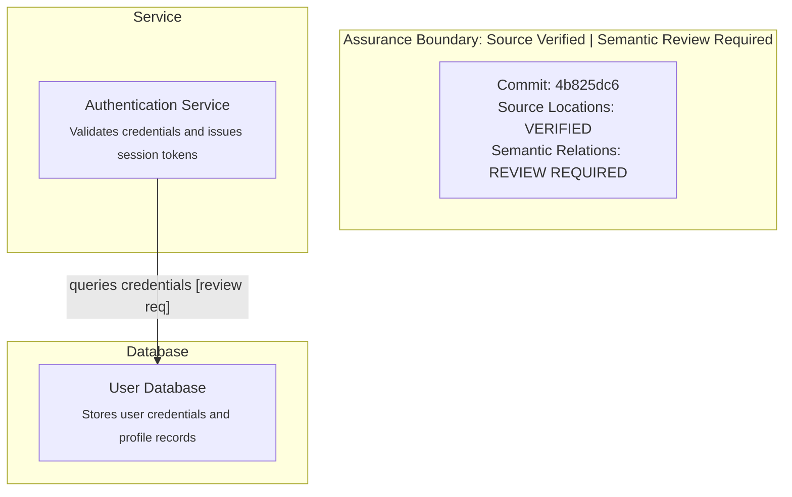

# Code Evidence in Architecture Diagrams

Generate verifiable, tamper-resistant Mermaid architecture diagrams backed by pinned Git commits using the canonical helper `architecture_evidence.py`.

Canonical script location: `global/codex/skills/design-code-architecture/scripts/architecture_evidence.py`

---

## Why Code Evidence?

Standard architecture diagrams frequently suffer from "drift" or unsupported claims:
- Arrows represent assumed interactions rather than real call paths.
- Components reference outdated directory structures or files that no longer exist.
- Working trees are mutable, making snapshots unverifiable.

The **Architecture Evidence** workflow solves this by anchoring architectural claims to immutable Git commits:
1. **Pinned commit**: All code references inspect `git show <commit>:<path>` via hidden subprocesses. The local working tree is never trusted as evidence.
2. **Exact citations**: References declare bounded 1-based line spans (`start_line`, `end_line`) and exact quoted excerpts.
3. **Deterministic Mermaid output**: Component IDs and labels are sanitized and safely escaped (`#quot;`, `#lt;`, `#gt;`, etc.) to prevent Mermaid syntax corruption.
4. **Atomic publishing**: Output `.mmd` diagrams are published via atomic replacement only after 100% of citations pass validation. If validation fails, any previously valid diagram survives untouched.

---

## Honest Assurance Boundary

> [!IMPORTANT]
> **Source-location validation is NOT semantic proof.**
> - What validation proves: The specified file path, bounded line span, and quoted text exist exactly as declared in the immutable Git object database at the pinned commit.
> - What validation DOES NOT prove: It does NOT prove semantic causality, architectural integrity, completeness, or runtime truth.
> - **All semantic relation assertions remain explicitly REVIEW REQUIRED.** In both the validation diagnostic report and the generated Mermaid diagram, relations are annotated with `[review req]` and an Assurance Boundary notice.

---

## Manifest Format (`manifest.json`)

The architecture evidence manifest is a minimal JSON document:

```json
{
  "commit": "4b825dc642cb6eb9a060e54bf8d69288fbee4904",
  "components": [
    {
      "id": "auth_service",
      "name": "Authentication Service",
      "type": "service",
      "description": "Validates credentials and issues session tokens",
      "evidence": [
        {
          "path": "src/auth/service.py",
          "start_line": 15,
          "end_line": 20,
          "excerpt": "def authenticate(user, password):\n    if not user or not password:\n        return False\n    return verify_hash(user, password)"
        }
      ]
    },
    {
      "id": "user_db",
      "name": "User Database",
      "type": "database",
      "description": "Stores user credentials and profile records",
      "evidence": [
        {
          "path": "migrations/001_users.sql",
          "start_line": 1,
          "end_line": 5,
          "excerpt": "CREATE TABLE users (\n    id SERIAL PRIMARY KEY,\n    email VARCHAR(255) NOT NULL UNIQUE,\n    password_hash VARCHAR(255) NOT NULL\n);"
        }
      ]
    }
  ],
  "relations": [
    {
      "from": "auth_service",
      "to": "user_db",
      "type": "reads",
      "label": "queries credentials"
    }
  ],
  "facts": [
    {
      "id": "fact_pw_hash",
      "claim": "Password authentication relies on argon2 hashing",
      "component": "auth_service",
      "evidence": [
        {
          "path": "src/auth/service.py",
          "start_line": 22,
          "end_line": 23,
          "excerpt": "def verify_hash(user, password):\n    return argon2.verify(user.hash, password)"
        }
      ]
    }
  ],
  "assumptions": [
    {
      "id": "assump_single_tenant",
      "claim": "Database operates in single-tenant mode",
      "status": "review_required"
    }
  ]
}
```

### Validation Rules

- **Commit**: Must be a valid 40- or 64-character hex SHA present in the target Git repository.
- **Paths**: Must be safe repository-relative POSIX paths. Rejects leading slashes, drive letters, `..` traversal, control characters, and symlinks.
- **Spans**: 1-based indices (`start_line >= 1`), bounded (`end_line >= start_line`), maximum 500 lines per evidence citation.
- **Excerpts**: Must exactly match the slice of lines from `git show <commit>:<path>`.
- **References**: Every `from` and `to` in `relations` and `component` in `facts` must reference a declared component `id`.

---

## CLI Usage

### 1. Validate Manifest
Validates code citations and manifest structure without rendering:

```bash
python -B global/codex/skills/design-code-architecture/scripts/architecture_evidence.py validate \
  manifest.json \
  --repo /path/to/repo \
  --diagnostics diagnostics.json
```

Output:
```
Architecture Evidence Verification: VALID
Pinned Commit: 4b825dc642cb6eb9a060e54bf8d69288fbee4904
Components: 2, Relations: 1
Assurance Boundary: Source locations verified; semantic relations remain REVIEW_REQUIRED.
```

### 2. Render Deterministic Mermaid Diagram
Validates citations first, then atomically generates and publishes `.mmd`:

```bash
python -B global/codex/skills/design-code-architecture/scripts/architecture_evidence.py render \
  manifest.json \
  --output docs/architecture.mmd \
  --repo /path/to/repo
```

If validation fails, `docs/architecture.mmd` is NOT created or modified; any previously existing valid diagram is preserved.

### 3. Export to PNG/SVG with `mmdc`
Once the validated `.mmd` is published, use the standard `mmdc` workflow:

```bash
mmdc -i docs/architecture.mmd -o docs/architecture.png -w 2048 --backgroundColor white
```

---

## Assurance Boundary Legend in Diagram

Rendered diagrams automatically include the assurance notice and review requirements:


